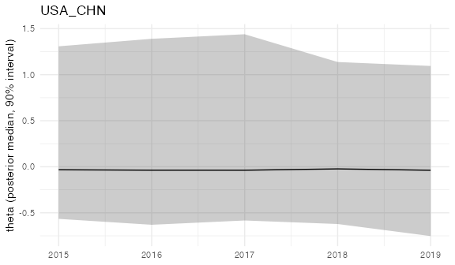

<!-- dyad_time_series.Rmd is generated from dyad_time_series.Rmd.orig by vignettes/precompile.R,
which needs CmdStan. Edit the .Rmd.orig file, then re-knit. -->


This vignette walks through fitting `bilatr`'s dyadic IRT model to a
**single dyad's** event time series: data prep, fitting, posterior
extraction, and basic convergence diagnostics. For fitting across many
dyads at once with hierarchical pooling, see `vignette("panel_model")`.

## 1. Data prep

In a real workflow you'd start from raw GDELT event data, or any other
event table in the format documented at `?bilatr_event_data`:


``` r
library(bilatr)

# a quick look: download, filter, and read one day's events, keeping
# nothing on disk
events <- download_gdelt("2020-01-01")
events <- recode_cameo(events)

# for real work: keep the zips as a cache and read them yourself
status <- download_gdelt("2020-01-01", "2020-01-31", dest_dir = "data/gdelt_raw")
events <- read_gdelt(status$path[status$status %in% c("downloaded", "cached")])
events <- recode_cameo(events)
```

For this vignette we simulate a small, self-contained event set for one
dyad so the example runs without a network connection or a local GDELT
archive:


``` r
library(bilatr)
library(dplyr)
#> 
#> Attaching package: 'dplyr'
#> The following objects are masked from 'package:stats':
#> 
#>     filter, lag
#> The following objects are masked from 'package:base':
#> 
#>     intersect, setdiff, setequal, union

set.seed(42)
n_events <- 400
dates <- format(
  sample(seq(as.Date("2015-01-01"), as.Date("2019-12-31"), by = "day"), n_events, replace = TRUE),
  "%Y%m%d"
)
events <- tibble::tibble(
  Actor1CountryCode = "USA",
  Actor2CountryCode = "CHN",
  SQLDATE = as.integer(dates),
  EventCode = sample(cameo_lookup$CAMEOEVENTCODE, n_events, replace = TRUE)
)
events <- recode_cameo(events, code_col = "EventCode")
#> recode_cameo(): 3 row(s) matched a bare top-level CAMEO root code with no ModifiedRootCode (its sub-codes span several classes).
```

`recode_cameo()` attaches 11 columns from the package's built-in
[cameo_lookup] table (no external CAMEO reference package required):
`CAMEOLabel`, `GoldsteinScore`, and three event-class schemes with their
labels and underlying codes: `QuadClass`, `QuadClassName`,
`QuadClassEventCodes`; `PentaClass`, `PentaClassName`,
`PentaClassEventCodes`; and `ModifiedRootCode`,
`ModifiedRootCodeName`, `ModifiedRootCodeEventCodes`. `QuadClass` is the
same mapping as GDELT's own `QuadClass`; see `?cameo_lookup` for the
schemes.

## 2. Aggregate to a dyad-period table

[aggregate_events()] collapses events to one row per dyad and period,
with one count column per event class (the format documented at
`?bilatr_dyad_period_data`). Any other source of already aggregated
dyad-period counts can be used instead; see `vignette("panel_model")`,
"Using your own aggregated data".


``` r
agg <- aggregate_events(
  events,
  grouping_var = "PentaClass",
  resolution = "yearly",
  start = "2015-01-01",
  end = "2019-12-31"
)
agg
#> # A tibble: 5 × 10
#>   dyad    actor1 actor2  year w_send   `0`   `1`   `2`   `3`   `4`
#>   <chr>   <chr>  <chr>  <int>  <dbl> <int> <int> <int> <int> <int>
#> 1 USA_CHN USA    CHN     2015      1    10    12     9    29    18
#> 2 USA_CHN USA    CHN     2016      1     5     8    10    35    21
#> 3 USA_CHN USA    CHN     2017      1    10    10    10    35    23
#> 4 USA_CHN USA    CHN     2018      1    13    15    18    28     9
#> 5 USA_CHN USA    CHN     2019      1    13     6     9    28    16
```

## 3. Fit

[fit_dyad_ts()] takes the table directly. It builds the Stan data with
[prepare_stan_data()], checks that there is exactly one dyad, and fits
the model with `threads_per_chain = 1` by default (reduce_sum has
nothing to chunk across when there's only one dyad).

`reference_category` orients the latent scale: θ is oriented so that
higher values make `reference_category` more likely relative to the
other action types. With a cooperative reference category, higher θ
means more cooperative relations, so here we use PentaClass 1 (verbal
cooperation). It becomes `alpha[1]`, the discrimination parameter the
model always reports as non-negative via an orientation fold (see
`inst/stan/bilatr_alphanorm.stan`'s header, "IDENTIFICATION: ORIENTATION
FOLD"); the `reference_category` argument of `?prepare_stan_data` has
the details. Every other action class's discrimination is
freely estimated subject to `alpha` summing to exactly 0 across all
classes (RMS normalized to 1) -- there is no single fixed-at-1 element.

The example below uses a short warmup/sampling run (this vignette was
computed ahead of time, with CmdStan, and is kept quick to re-run); real
analyses should use `iter_warmup`/`iter_sampling`
in the low thousands and check the diagnostics below before trusting
the result.


``` r
fit <- fit_dyad_ts(
  agg,
  reference_category = "1", # verbal cooperation
  chains = 2,
  parallel_chains = 2,
  iter_warmup = 300,
  iter_sampling = 300,
  seed = 1,
  refresh = 0
)
```

The fit carries the Stan data it was fit to:


``` r
stan_data <- attr(fit, "stan_data")
stan_data$D # a single dyad
#> [1] 1
stan_data$T # number of years
#> [1] 5
stan_data$A # number of action classes
#> [1] 5
```

## 4. Extract

[extract_theta()] reattaches human-readable dyad identifiers to the
posterior summary of the latent bilateral-relations trajectory. It finds them in
the Stan data attached to `fit`, so no second argument is needed:


``` r
theta <- extract_theta(fit)
theta
#> # A tibble: 5 × 11
#>   dyad_id time_index     mean   `5%`   `50%` `95%` dyad    dyad2   actor1 actor2
#>     <int>      <int>    <dbl>  <dbl>   <dbl> <dbl> <chr>   <chr>   <chr>  <chr> 
#> 1       1          1  0.00254 -0.566 -0.0327  1.31 USA_CHN CHN_USA USA    CHN   
#> 2       1          2 -0.00670 -0.630 -0.0372  1.39 USA_CHN CHN_USA USA    CHN   
#> 3       1          3  0.00659 -0.583 -0.0376  1.44 USA_CHN CHN_USA USA    CHN   
#> 4       1          4 -0.00401 -0.622 -0.0232  1.14 USA_CHN CHN_USA USA    CHN   
#> 5       1          5 -0.0289  -0.753 -0.0380  1.09 USA_CHN CHN_USA USA    CHN   
#> # ℹ 1 more variable: year <int>
```


``` r
library(ggplot2)
ggplot(theta, aes(year, `50%`)) +
  geom_ribbon(aes(ymin = `5%`, ymax = `95%`), alpha = 0.25) +
  geom_line() +
  labs(x = NULL, y = "theta (posterior median, 90% interval)", title = "USA_CHN") +
  theme_minimal()
```

<div class="figure">

<p class="caption">The latent relations of USA_CHN by year: posterior median and 90% interval.</p>
</div>

The simulated event codes are drawn at random, so there is no real
trend to find here: the intervals are wide and overlap from year to
year.

[extract_alpha()] and [extract_mu_intercept()] extract the action-type
discrimination and intercept parameters, labeled with the event-class
values (again taken from the attached Stan data):


``` r
extract_alpha(fit)
#> # A tibble: 5 × 7
#>   variable    mean    `5%`   `50%` `95%` action_index event_class
#>   <chr>      <dbl>   <dbl>   <dbl> <dbl>        <int> <chr>      
#> 1 alpha[1]  0.771   0.0864  0.696   1.73            1 1          
#> 2 alpha[2] -0.0695 -1.67   -0.0181  1.47            2 0          
#> 3 alpha[3] -0.329  -1.67   -0.508   1.41            3 2          
#> 4 alpha[4] -0.286  -1.66   -0.309   1.29            4 3          
#> 5 alpha[5] -0.0856 -1.63   -0.0613  1.50            5 4
extract_mu_intercept(fit)
#> # A tibble: 5 × 7
#>   variable           mean   `5%`  `50%`  `95%` action_index event_class
#>   <chr>             <dbl>  <dbl>  <dbl>  <dbl>        <int> <chr>      
#> 1 mu_intercept[1]  0.288  -0.277  0.295  1.02             1 1          
#> 2 mu_intercept[2]  0.113  -1.59   0.249  0.687            2 0          
#> 3 mu_intercept[3]  0.247  -0.826  0.263  1.02             3 2          
#> 4 mu_intercept[4] -0.621  -1.02  -0.675 -0.137            4 3          
#> 5 mu_intercept[5] -0.0278 -0.664 -0.159  1.86             5 4
```

Note `sum(alpha)` and `sum(mu_intercept)` are exactly 0: both are
sum-to-zero by construction (the model's identification anchors), rather
than a single element fixed to a constant. `alpha[1]`'s *sign* is
always reported positive too, via an orientation fold (`alpha` and
`theta` are both multiplied by `sign(alpha_raw[1])` in `transformed
parameters` -- exact and Jacobian-free, since the likelihood only ever
sees their product) rather than a hard constraint on the sampled
parameter, so every fit already reports `theta` oriented toward the
reference category (here, higher `theta` means more verbal cooperation
relative to the other classes) with no post-hoc relabeling needed.

## 5. Diagnose

`cmdstanr`'s default posterior summary already includes R-hat and both
bulk and tail effective sample size; check these before drawing
conclusions from `theta`:


``` r
fit$summary(variables = c("alpha", "mu_intercept", "phi", "process_noise"))
#> # A tibble: 12 × 10
#>    variable       mean   median      sd     mad       q5      q95  rhat ess_bulk
#>    <chr>         <dbl>    <dbl>   <dbl>   <dbl>    <dbl>    <dbl> <dbl>    <dbl>
#>  1 alpha[1]     0.771    0.696  4.97e-1  0.538   0.0864     1.73   1.01    236. 
#>  2 alpha[2]    -0.0695  -0.0181 1.07e+0  1.50   -1.67       1.47   1.01     84.4
#>  3 alpha[3]    -0.329   -0.508  9.65e-1  1.08   -1.67       1.41   1.01    188. 
#>  4 alpha[4]    -0.286   -0.309  9.21e-1  1.06   -1.66       1.29   1.01    266. 
#>  5 alpha[5]    -0.0856  -0.0613 1.02e+0  1.24   -1.63       1.50   1.02    102. 
#>  6 mu_interc…   0.288    0.295  3.66e-1  0.302  -0.277      1.02   1.06     43.8
#>  7 mu_interc…   0.113    0.249  5.55e-1  0.308  -1.59       0.687  1.05     26.2
#>  8 mu_interc…   0.247    0.263  4.49e-1  0.323  -0.826      1.02   1.09     17.3
#>  9 mu_interc…  -0.621   -0.675  3.09e-1  0.262  -1.02      -0.137  1.03     47.4
#> 10 mu_interc…  -0.0278  -0.159  5.67e-1  0.207  -0.664      1.86   1.05     39.5
#> 11 phi[1]     505.     119.     1.93e+3 97.1    34.2     1088.     1.00     88.7
#> 12 process_n…   0.0933   0.0708 8.92e-2  0.0679  0.00610    0.264  1.03     62.8
#> # ℹ 1 more variable: ess_tail <dbl>
```

Look for `rhat` close to 1 (below ~1.01) and `ess_bulk`/`ess_tail` in the
hundreds or more per chain. `fit$diagnostic_summary()` reports any
divergent transitions or tree-depth saturation, which for a real fit
should be zero or reported here:


``` r
fit$diagnostic_summary()
#> Warning: 23 of 600 (4.0%) transitions ended with a divergence.
#> See https://mc-stan.org/misc/warnings for details.
#> $num_divergent
#> [1]  4 19
#> 
#> $num_max_treedepth
#> [1] 0 0
#> 
#> $ebfmi
#> [1] 0.7156208 1.1480679
```

If ESS is low or R-hat is elevated, the usual fixes are more sampling
iterations, tighter priors informed by domain knowledge, or (for
single-dyad fits especially, since there's no cross-dyad pooling to help
identify `theta0`/`phi`) more data.
