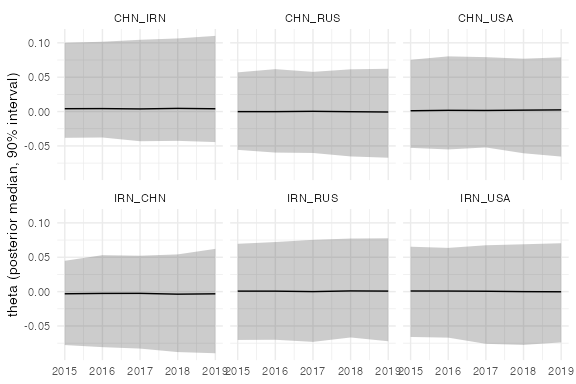

<!-- panel_model.Rmd is generated from panel_model.Rmd.orig by vignettes/precompile.R,
which needs CmdStan. Edit the .Rmd.orig file, then re-knit. -->


This vignette walks through fitting `bilatr`'s dyadic IRT model across
**multiple dyads at once**, with hierarchical partial pooling on process
noise, the dispersion parameter `phi`, and the initial latent state
`theta0`. For a single dyad, see `vignette("dyad_time_series")`; the
data-prep and extraction steps are the same, only the fitting call and
the presence of pooling differ.

## 1. Data prep

As in the single-dyad case, a real workflow starts from raw event data
recoded via [recode_cameo()]. Here we simulate a small panel of six
dyads so the example is self-contained:


``` r
library(bilatr)
library(dplyr)

set.seed(42)
countries <- c("USA", "CHN", "RUS", "IRN")
dyad_pairs <- expand.grid(a1 = countries, a2 = countries, stringsAsFactors = FALSE) %>%
  filter(a1 != a2)

n_events <- 3000
dates <- format(
  sample(seq(as.Date("2015-01-01"), as.Date("2019-12-31"), by = "day"), n_events, replace = TRUE),
  "%Y%m%d"
)
pair_idx <- sample(nrow(dyad_pairs), n_events, replace = TRUE)
events <- tibble::tibble(
  Actor1CountryCode = dyad_pairs$a1[pair_idx],
  Actor2CountryCode = dyad_pairs$a2[pair_idx],
  SQLDATE = as.integer(dates),
  EventCode = sample(cameo_lookup$CAMEOEVENTCODE, n_events, replace = TRUE)
)
events <- recode_cameo(events, code_col = "EventCode")
#> recode_cameo(): 15 row(s) matched a bare top-level CAMEO root code with no ModifiedRootCode (its sub-codes span several classes).
```

## 2. Aggregate to a dyad-period table

The call is identical in shape to the single-dyad case; the table
simply holds more than one dyad.


``` r
agg <- aggregate_events(
  events,
  grouping_var = "PentaClass",
  resolution = "yearly",
  start = "2015-01-01",
  end = "2019-12-31"
)
count(agg, dyad) # multiple dyads
#> # A tibble: 12 × 2
#>    dyad        n
#>    <chr>   <int>
#>  1 CHN_IRN     5
#>  2 CHN_RUS     5
#>  3 CHN_USA     5
#>  4 IRN_CHN     5
#>  5 IRN_RUS     5
#>  6 IRN_USA     5
#>  7 RUS_CHN     5
#>  8 RUS_IRN     5
#>  9 RUS_USA     5
#> 10 USA_CHN     5
#> 11 USA_IRN     5
#> 12 USA_RUS     5
```

## 3. Fit

[fit_panel()] builds the Stan data from the table and checks that there
are at least two dyads. Its defaults (`threads_per_chain = 1`,
`parallel_chains = 1`, `chunk_size = 1`) are conservative and run on
any machine. Panel-sized data is where within-chain parallelism pays
off: `threads_per_chain` sets how many threads `reduce_sum` uses per
chain, and `chunk_size` how many dyads' worth of likelihood evaluation
each `reduce_sum` task covers. Tune the two together for your data size
and hardware; [`vignette("tuning")`](tuning.html) shows how. This example runs two
chains in parallel with two threads each, and uses a short run (this
vignette was computed ahead of time, with CmdStan, and is kept quick to
re-run).


``` r
fit <- fit_panel(
  agg,
  reference_category = "1", # verbal cooperation
  min_n_events = 1,
  chunk_size = 4,
  chains = 2,
  parallel_chains = 2,
  threads_per_chain = 2,
  iter_warmup = 300,
  iter_sampling = 300,
  seed = 1,
  refresh = 0
)
```


``` r
stan_data <- attr(fit, "stan_data") # the Stan data the model was fit to
stan_data$D
#> [1] 12
```

## 4. Extract

The extraction functions work identically to the single-dyad case, now
returning one trajectory per dyad:


``` r
theta <- extract_theta(fit)
theta %>% count(dyad) # one row per dyad-period, D dyads
#> # A tibble: 12 × 2
#>    dyad        n
#>    <chr>   <int>
#>  1 CHN_IRN     5
#>  2 CHN_RUS     5
#>  3 CHN_USA     5
#>  4 IRN_CHN     5
#>  5 IRN_RUS     5
#>  6 IRN_USA     5
#>  7 RUS_CHN     5
#>  8 RUS_IRN     5
#>  9 RUS_USA     5
#> 10 USA_CHN     5
#> 11 USA_IRN     5
#> 12 USA_RUS     5

extract_alpha(fit)
#> # A tibble: 5 × 7
#>   variable    mean    `5%`   `50%` `95%` action_index event_class
#>   <chr>      <dbl>   <dbl>   <dbl> <dbl>        <int> <chr>      
#> 1 alpha[1]  0.865   0.0707  0.835   1.75            1 1          
#> 2 alpha[2] -0.373  -1.72   -0.500   1.40            2 0          
#> 3 alpha[3] -0.245  -1.73   -0.265   1.48            3 2          
#> 4 alpha[4] -0.0962 -1.71   -0.0696  1.46            4 3          
#> 5 alpha[5] -0.150  -1.53   -0.194   1.38            5 4
```


``` r
library(ggplot2)
six <- head(sort(unique(theta$dyad)), 6)
ggplot(filter(theta, dyad %in% six), aes(year, `50%`)) +
  geom_ribbon(aes(ymin = `5%`, ymax = `95%`), alpha = 0.25) +
  geom_line() +
  facet_wrap(vars(dyad), ncol = 3) +
  labs(x = NULL, y = "theta (posterior median, 90% interval)") +
  theme_minimal()
```

<div class="figure">

<p class="caption">The latent relations of six of the directed dyads by year: posterior median and 90% interval.</p>
</div>

The hierarchical pooling shows up in the dyad-level parameters, e.g.
`phi` (one value per dyad, pooled toward `mu_log_phi`/`sigma_log_phi`)
and `theta0` (pooled toward `sigma_theta0`; its population mean is
pinned at exactly 0 rather than a separately estimated location):


``` r
fit$summary(variables = c("mu_log_phi", "sigma_log_phi", "sigma_theta0"))
#> # A tibble: 3 × 10
#>   variable      mean median     sd    mad      q5    q95  rhat ess_bulk ess_tail
#>   <chr>        <dbl>  <dbl>  <dbl>  <dbl>   <dbl>  <dbl> <dbl>    <dbl>    <dbl>
#> 1 mu_log_phi  4.99   5.01   0.453  0.392  4.17    5.67    1.03    92.7      82.4
#> 2 sigma_log_… 0.692  0.449  0.675  0.371  0.102   2.30    1.18     8.61     31.1
#> 3 sigma_thet… 0.0343 0.0276 0.0287 0.0245 0.00332 0.0877  1.00   167.      193.
head(fit$summary(variables = c("phi", "theta0")), 6)
#> # A tibble: 6 × 10
#>   variable  mean median    sd   mad    q5   q95  rhat ess_bulk ess_tail
#>   <chr>    <dbl>  <dbl> <dbl> <dbl> <dbl> <dbl> <dbl>    <dbl>    <dbl>
#> 1 phi[1]    301.   145. 1413.  83.3  51.1  380.  1.01    196.     205. 
#> 2 phi[2]    533.   213. 1606. 111.   95.4 1248.  1.05     52.6     59.6
#> 3 phi[3]    342.   189. 1210.  99.2  81.3  728.  1.01    222.     186. 
#> 4 phi[4]    387.   205. 1076. 115.   87.4 1016.  1.06     30.6     58.4
#> 5 phi[5]    227.   164.  239.  93.4  62.5  678.  1.02    274.     168. 
#> 6 phi[6]    303.   176.  599.  94.8  74.3  800.  1.03    177.     135.
```

## 5. Diagnose

With a panel, it's worth checking whether any *specific* dyads are
poorly identified (e.g. very low event counts) rather than only
looking at global summaries -- but also making sure that expected noise
in sparse dyads' own `theta` trajectories doesn't bury a real problem
in a shared/global parameter. [diagnose_convergence()] triages
`fit$summary()` by parameter tier for exactly this reason; see
`vignette("diagnostics")` for a full walkthrough. Briefly:


``` r
fit$diagnostic_summary()
#> Warning: 19 of 600 (3.0%) transitions ended with a divergence.
#> See https://mc-stan.org/misc/warnings for details.
#> $num_divergent
#> [1]  7 12
#> 
#> $num_max_treedepth
#> [1] 0 0
#> 
#> $ebfmi
#> [1] 0.5285484 0.6788453

diagnose_convergence(fit)
#> <bilatr_diagnostics>
#> 
#> == Tier 1: global/shared parameters (10/16 flagged) ==
#> # A tibble: 10 × 5
#>    variable         rhat ess_bulk ess_tail flagged
#>    <chr>           <dbl>    <dbl>    <dbl> <lgl>  
#>  1 lp__            1.10     16.2      83.4 TRUE   
#>  2 mu_intercept[2] 1.02    544.      346.  TRUE   
#>  3 mu_intercept[4] 1.00    374.      309.  TRUE   
#>  4 mu_intercept[5] 1.01    423.      329.  TRUE   
#>  5 sigma_theta0    1.00    167.      193.  TRUE   
#>  6 sigma_log_noise 1.00    356.      187.  TRUE   
#>  7 mu_log_phi      1.03     92.7      82.4 TRUE   
#>  8 sigma_log_phi   1.18      8.61     31.1 TRUE   
#>  9 alpha[1]        1.01    334.      513.  TRUE   
#> 10 alpha[3]        1.000   382.      442.  TRUE   
#> 
#> == Tier 2: per-dyad hierarchical parameters (12 dyads, 0 worse than expected for their n_dt) ==
#> # A tibble: 12 × 15
#>    dyad_id  n_dt log_process_noise_raw…¹ phi_rhat theta0_rhat process_noise_rhat
#>      <int> <dbl>                   <dbl>    <dbl>       <dbl>              <dbl>
#>  1       1   262                   1.00      1.01       1.01               1.00 
#>  2       2   234                   1.00      1.05       1.00               1.000
#>  3       3   248                   1.03      1.01       1.01               1.01 
#>  4       4   236                   0.999     1.06       1.00               1.00 
#>  5       5   256                   1.01      1.02       1.00               1.01 
#>  6       6   219                   1.00      1.03       1.01               1.01 
#>  7       7   265                   1.00      1.04       1.00               1.01 
#>  8       8   241                   1.00      1.02       1.00               1.01 
#>  9       9   247                   1.01      1.01       1.00               1.00 
#> 10      10   267                   1.00      1.04       1.000              1.00 
#> 11      11   280                   1.00      1.04       1.01               1.00 
#> 12      12   245                   1.00      1.06       1.00               1.00 
#> # ℹ abbreviated name: ¹​log_process_noise_raw_rhat
#> # ℹ 9 more variables: log_process_noise_raw_ess_bulk <dbl>, phi_ess_bulk <dbl>,
#> #   theta0_ess_bulk <dbl>, process_noise_ess_bulk <dbl>,
#> #   log_process_noise_raw_ess_tail <dbl>, phi_ess_tail <dbl>,
#> #   theta0_ess_tail <dbl>, process_noise_ess_tail <dbl>,
#> #   worse_than_expected <lgl>
#> 
#> == Tier 3: per-dyad-period latent states (theta, aggregated; 12 dyads) ==
#> 100% of dyads have min theta ESS below threshold (400), median n_dt among them: 248.
```

`diagnose_convergence()` judges each dyad's diagnostics against how much
data it has, `n_dt`, which it computes from the Stan data attached to
the fit (each dyad's total event count).

Dyads flagged as worse than expected for their `n_dt` (Tier 2) or with
low minimum `theta` ESS concentrated at low `n_dt` (Tier 3) are the
ones most likely to need more data, a higher `min_n_events` cutoff, or
closer inspection of their raw event counts before trusting their
`theta` trajectory. Any Tier 1 issue, by contrast, is a global problem
and should be investigated regardless of any individual dyad's
sparsity.

## 6. Using your own aggregated data

Nothing above depends on GDELT or CAMEO. [fit_panel()] and
[fit_dyad_ts()] take any dyad-period table of action counts in the
format documented at `?bilatr_dyad_period_data`: one row per dyad and
period, an integer period index (gaps are allowed and become unobserved
periods), and two or more count columns.


``` r
my_counts <- tibble::tibble(
  dyad = rep(c("A-B", "A-C", "B-C"), each = 4),
  week_id = rep(c(1L, 2L, 3L, 5L), times = 3), # week 4 unobserved
  meetings = c(3, 1, 0, 2, 4, 4, 2, 1, 0, 1, 1, 0),
  protests = c(0, 1, 2, 0, 1, 0, 0, 3, 2, 2, 0, 1),
  sanctions = c(0, 0, 1, 1, 0, 0, 0, 1, 3, 1, 2, 2)
)

fit_own <- fit_panel(
  my_counts,
  time = "week_id",
  action_cols = c(meetings, protests, sanctions), # or c("meetings", ...)
  reference_category = "meetings",
  chains = 2
)
extract_theta(fit_own)
```

`time` names the period column and `action_cols` the count columns (a
character vector or a tidyselect expression such as
`starts_with("n_")`). `time_range = c(min, max)` pins the periods
covered, and so `T`; by default it is the data's own range. The Stan
data's `Y` is a dense dyads x periods x action types array, so very
fine periods (e.g. days) are only practical for few dyads or short
windows; see `?prepare_stan_data`.

The country-offset model `stan_model = "stable_gamma"` needs to know
which two actors make up each dyad: add `actor1` and `actor2` columns
(the dyad column can then be left out, and is built as
`actor1_actor2`). Without them `stable_gamma` errors before compiling;
`stable` and `ou` don't need them. For undirected data, pass
`directed = FALSE` and, if you can, a `w_send` column with the share of
each dyad's events sent by `actor1`. Without `w_send`, `stable_gamma`
assumes 0.5 for every dyad and warns. [aggregate_events()] computes
`w_send` from event data.
